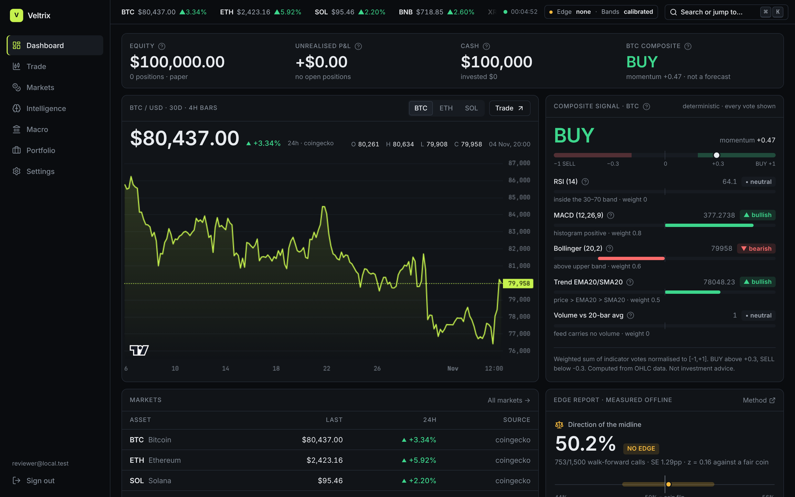
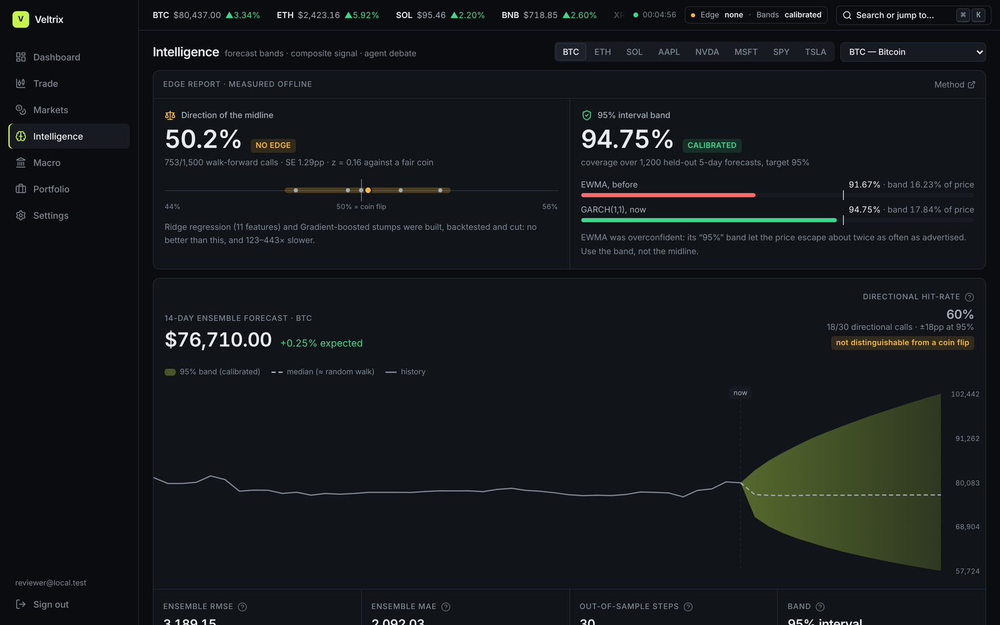
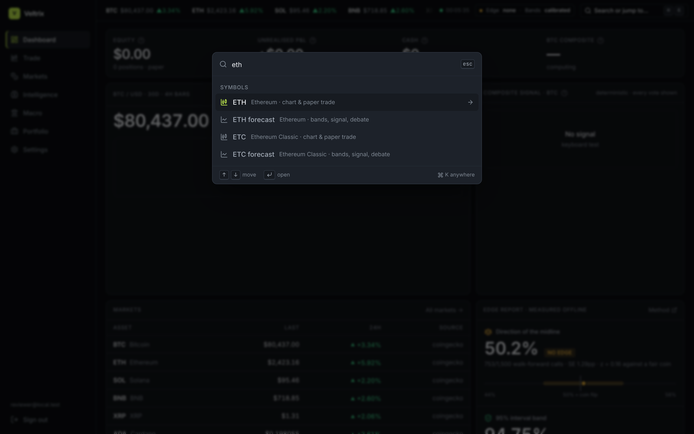
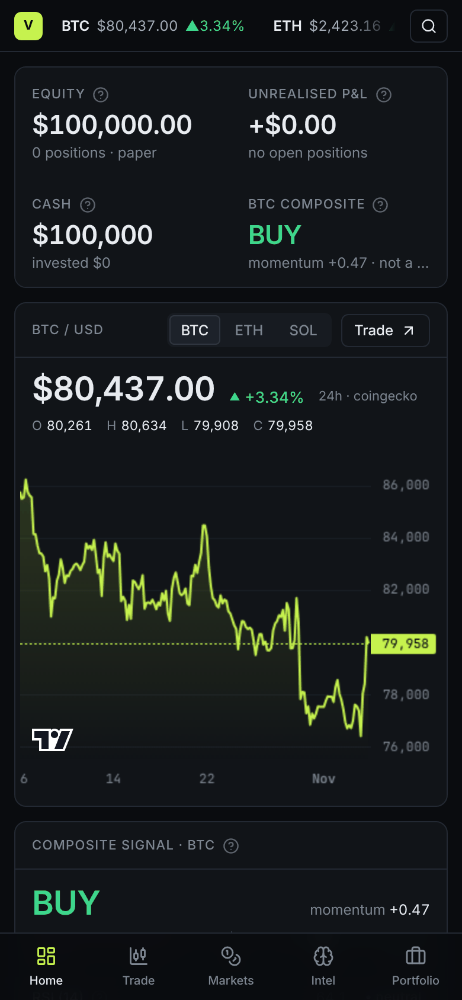
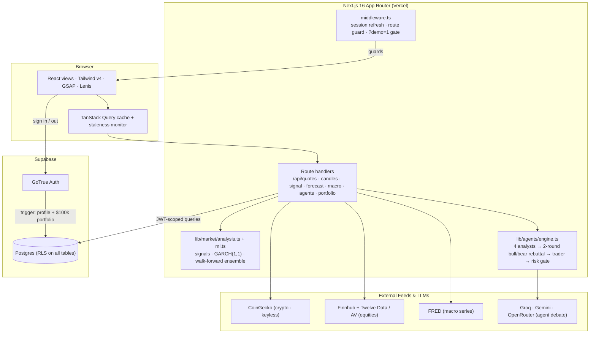

# Veltrix

**A market-analytics terminal that tells you when there is no edge.**

[](https://github.com/VenkataVinesh/Veltrix/actions/workflows/frontend.yml)
[](https://veltrix-terminal-frontend.vercel.app)


Live crypto and equity pricing, an auditable technical signal engine that shows every vote, walk-forward-validated forecasts with GARCH(1,1) calibrated bands, a grounded multi-agent LLM debate, and paper trading on row-level-secured portfolios.
Next.js 16 · TypeScript · Supabase · lightweight-charts.



## Measured results

Every figure below is produced by code in this repository (`lib/evaluation.ts`, `lib/market/analysis.ts`, `lib/market/ml.ts`) and can be reproduced offline in one command via `npm run evaluate`:

| What | Result | Verdict |
|---|---|---|
| Directional hit-rate of the forecast midline, pooled over 1,500 out-of-sample walk-forward calls (6 symbols × 250) | **50.2%** (753/1,500), SE 1.29pp, $z = 0.16$, $p_{\text{Holm}} = 1.00$ | **No edge.** The product says so on the page |
| 95% interval coverage over 1,200 held-out 5-day forecasts | **94.75%** with GARCH(1,1) (Kupiec $\text{LR}_{\text{POF}} = 0.16, p = 0.693$), up from **91.67%** with EWMA ($\text{LR}_{\text{POF}} = 24.93, p < 0.0001$) | **Calibrated.** Use the band, not the midline |
| Candidate directional models (Ridge, Gradient-Boosted Stumps, Kalman State-Space, 5d Seasonal-Naive) | All 95% CIs span 50% ($p_{\text{Holm}} = 1.00$); learned models run **123–443× slower** | **Cut** |
| Candidate interval models (GJR-GARCH, Parkinson HAR-RV, Split-Conformal GARCH) | GJR-GARCH passes Kupiec (**94.67%**, $p = 0.60$) at 2.5× latency; HAR-RV (**91.67%**) and Conformal (**93.08%**) fail Kupiec ($p < 0.005$) | **Benchmarked & documented** |

Full protocol, per-symbol tables, Kupiec/Christoffersen/Winkler/QLIKE metrics, and how to re-run:
- **[docs/FORECAST-EVALUATION.md](docs/FORECAST-EVALUATION.md)** — methodology, pre-registered rules, and model-by-model results
- **[docs/DECISIONS.md](docs/DECISIONS.md)** — architectural decisions, what was tried and cut, and what comes next

| Forecast and edge report | Command palette (⌘K) | Mobile |
|---|---|---|
|  |  |  |

---

## Why this exists

Most trading dashboards show you a confident number and hide how they got it. A "92% confidence BUY signal" is easy to render and impossible to check.

Veltrix is built on the opposite premise: **if a number can't be traced, it doesn't ship.**

- Every BUY/SELL exposes the individual indicator votes that produced it, with weights.
- Forecast confidence is a *measured* walk-forward hit-rate — when the model has no edge, the UI says ~50% instead of inventing certainty.
- There are no mock data paths for market feeds. If a provider is unavailable, the screen says so rather than falling back to invented prices.

---

## Live demo (no login required)

- **Explore immediately (read-only demo mode):** **[veltrix-terminal-frontend.vercel.app/dashboard?demo=1](https://veltrix-terminal-frontend.vercel.app/dashboard?demo=1)** — opens the full terminal with a clearly-labelled **seeded demo portfolio** (`0.45 BTC`, `6 ETH`, `55 SOL` + `$42.5k` cash) marked to live CoinGecko prices.
- **Full account:** Sign up at **[veltrix-terminal-frontend.vercel.app](https://veltrix-terminal-frontend.vercel.app)**. A `handle_new_user` Postgres trigger provisions a `$100,000` paper portfolio on signup, isolated by Row-Level Security.

---

## Architecture



### Request path, end to end

1. **`middleware.ts`** runs on every non-static request, refreshes the Supabase session cookie, allows read-only demo sessions (`?demo=1` / `veltrix_demo=1`), and redirects unauthenticated visitors away from protected routes.
2. **Route handlers** fetch OHLC/quotes/macro series from the providers, run the signal and forecast engines server-side, and return typed JSON. Market endpoints use Next's `revalidate` for edge caching; `/api/portfolio` and `/api/agents` are `force-dynamic`.
3. **Postgres reads and writes** go through the caller's JWT, so PostgreSQL Row-Level Security (RLS) — not application code — is the authorisation boundary.

---

## The signal engine

`computeSignal()` scores five technical components, each casting a weighted vote:

| Component | Weight | Bullish when | Bearish when |
|---|---|---|---|
| RSI (14) | 1.0 | < 30 (oversold) | > 70 (overbought) |
| MACD (12,26,9) | 0.8 | histogram > 0 | histogram < 0 |
| Bollinger (20,2) | 0.6 | close below lower band | close above upper band |
| Trend EMA20/SMA20 | 0.5 | price > EMA20 > SMA20 | price < EMA20 < SMA20 |
| Volume vs 20-bar avg | 0.3 | > 1.5× average | — |

The votes are summed, normalised to `[-1, +1]`, and thresholded: **BUY above +0.3, SELL below −0.3.**

- **Momentum is rounded *before* thresholding** (`Math.round(raw * 1000) / 1000`) so floating-point representation (`0.8 - 0.5 = 0.30000000000000004`) never makes a score of `0.30` render beside a `BUY`.
- **Bullish/bearish probabilities derive from the same momentum**, so the headline and the odds never disagree.

---

## The forecast & volatility engine

Three baseline models are ensembled by **inverse-RMSE weights from a walk-forward backtest**:

| Model | Method |
|---|---|
| `drift_ewma` | Geometric drift (shrunk 0.5× toward zero) with RiskMetrics EWMA volatility ($\lambda = 0.94$) |
| `ar` | AR(5) on log returns, OLS via normal equations + Gaussian elimination with partial pivoting |
| `naive` | Random walk — the benchmark every other model must beat |

Confidence bands are 95% intervals from a **GARCH(1,1)** conditional variance path (fitted by variance-targeted Gaussian maximum likelihood) when history is at least 50 bars, and from EWMA volatility scaled by $\sqrt{\text{horizon}}$ otherwise.

Additional candidate models (`ridge`, `gbm`, `kalman`, `seasonal_naive`, and volatility models `gjr_garch`, `har_rv`, `garch_conformal`) are implemented in `lib/market/ml.ts` and evaluated via `lib/evaluation.ts` and `npm run evaluate`.

---

## Running locally & reproducing the evaluation

```bash
git clone https://github.com/VenkataVinesh/Veltrix.git
cd Veltrix
npm install
npm run dev
```

Open <http://localhost:3000> (or <http://localhost:3000/dashboard?demo=1> to jump straight into the read-only demo terminal). Crypto quotes, candles, signals, and forecasts work out of the box with **zero configuration**.

### Reproduce all published evaluation tables offline

```bash
npm run evaluate   # runs scripts/evaluate.ts against tests/fixtures/equities-daily-2026-11-04.json
                   # and writes docs/EVALUATION-BENCHMARK.json (no API keys required)
```

### Quality & CI checks

```bash
npm test                                    # Vitest suite (52 tests: anti-lookahead referee, Kupiec/Christoffersen, ML, indicators, routes)
npx tsc --noEmit                            # strict TypeScript check
npm run lint                                # ESLint
npm audit --omit=dev --audit-level=high     # zero high/critical production advisories
npm run build                               # Next.js 16 production build
```

CI (`.github/workflows/frontend.yml`) enforces all five on every push and pull request.

---

## Project layout

```
app/
  (app)/           dashboard · trade · markets · intelligence · macro · portfolio · settings
  api/             quotes · candles · signal · forecast · macro · agents · portfolio
  login/ signup/   Supabase auth + one-click read-only demo entry
  page.tsx         cinematic landing
components/
  app-shell.tsx    rail, live status bar with staleness detection, demo banner, shortcuts
  command-palette.tsx  ⌘K palette (pages, 79 symbols, actions)
  edge-report.tsx  the measured-results panel (direction + GARCH Kupiec calibration)
  motion/          preloader, kinetic text, reveals, magnetic, cursor, marquee
  views/           one component per screen (loading, empty, error-with-retry, stale/demo states)
  ui/glossary.tsx  plain-English definition for every quantitative term
  hero-canvas.tsx  generative live-data hero
  price-chart.tsx  lightweight-charts wrapper with screen-reader summary
lib/
  evaluation.ts    purged walk-forward referee, Kupiec POF, Christoffersen, Winkler, QLIKE
  market/          providers.ts · analysis.ts · ml.ts (GARCH, GJR-GARCH, HAR-RV, Conformal,
                   Kalman, Ridge, GBM) · macro.ts (FRED series)
  agents/          multi-agent debate — sourced evidence gathering, prompts, 2-round engine
  supabase/        client · server · config
scripts/
  evaluate.ts      deterministic offline evaluation runner (`npm run evaluate`)
tests/             vitest suites (evaluation, ml, analysis, routes) + captured market fixtures
docs/
  FORECAST-EVALUATION.md   methodology, pre-registered protocol, and model-by-model results
  EVALUATION-BENCHMARK.json machine-readable output of `npm run evaluate`
  DECISIONS.md             engineering trade-offs, negative results, and roadmap
  DESIGN.md                tokens, type scale, accessibility, and layout rules
```

---

## Honest limitations

- **The forecast has no directional edge, and this is measured.** Pooled over 1,500 out-of-sample walk-forward calls the hit-rate is 50.2% ($z = 0.16, p_{\text{Holm}} = 1.00$) — a coin flip. Seven directional models were tested; none beat chance. What *is* calibrated is the 95% GARCH(1,1) band: 94.75% measured coverage against 95% nominal (Kupiec $p = 0.693$). Use the band, not the midline.
- **Sell orders are not implemented.** The button is visibly disabled and labelled.
- **Paper trading only.** No broker integration; no real order ever leaves the browser.
- **Not investment advice.** The signal engine is a transparent technical composite, not alpha.
- **Free-tier rate limits.** CoinGecko, Finnhub, and Twelve Data all throttle; heavy refreshing will 429. Twelve Data's free daily budget is 800 credits.
- **Equities need a key.** Without `TWELVEDATA_API_KEY` there is no live equity history, so the app reports equity history as unavailable rather than inventing bars (the offline benchmark uses the pinned fixture in `tests/fixtures/`).

---

## Licence

MIT — see [LICENSE](LICENSE). Security policy: [SECURITY.md](SECURITY.md). Third-party credits: [CREDITS.md](CREDITS.md).

Built by **Venkata Vinesh Kumar Reddy Atluri** ·
[Portfolio](https://venkatavinesh.github.io/PortFolio_Build_Gem/) ·
[LinkedIn](https://www.linkedin.com/in/venkat-vinesh)
