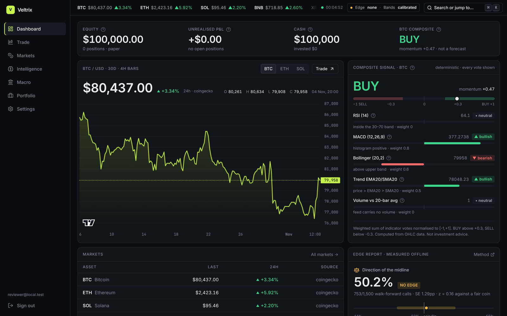
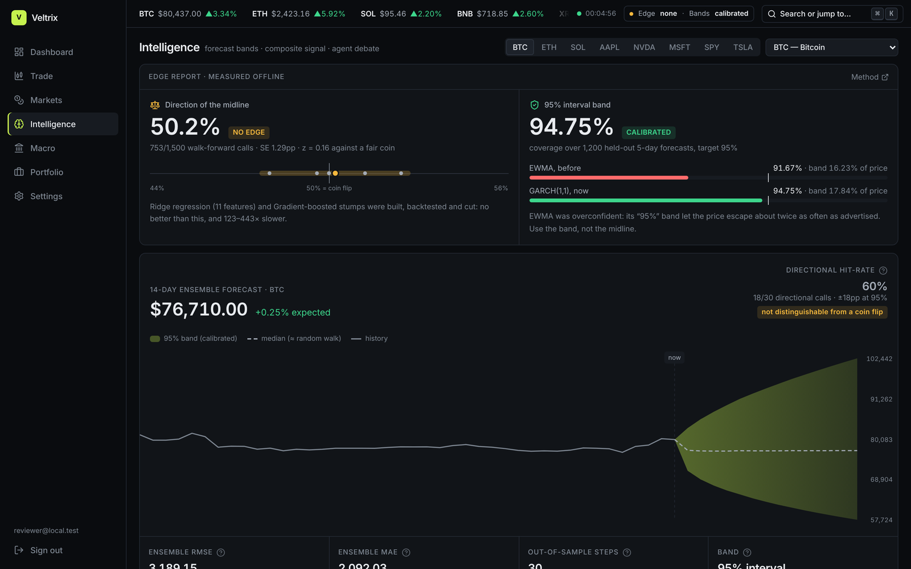
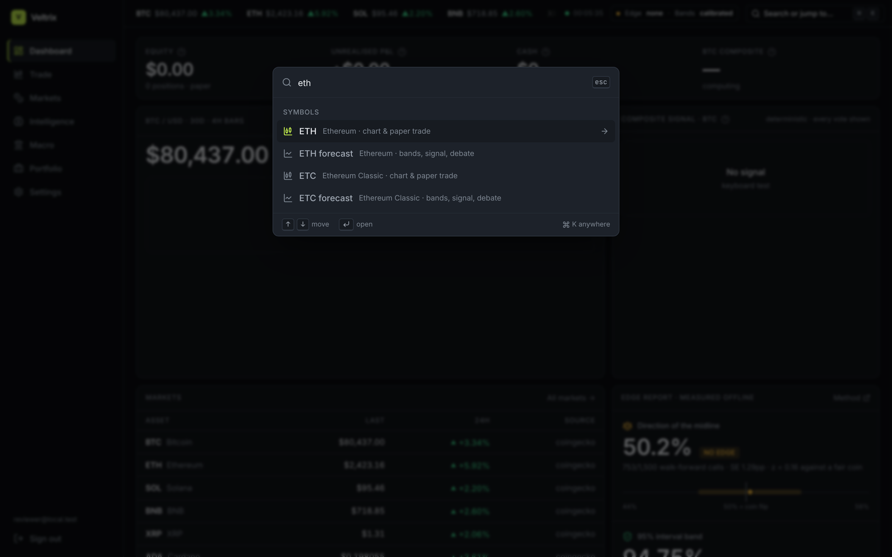
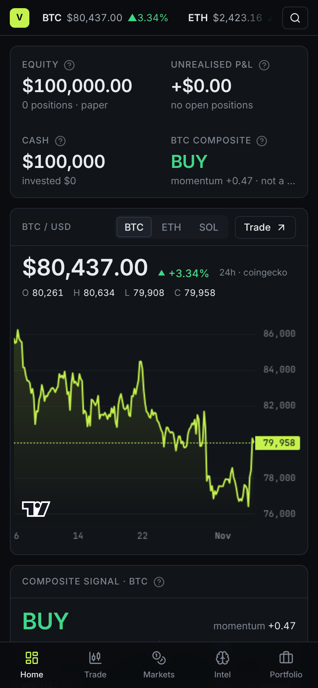
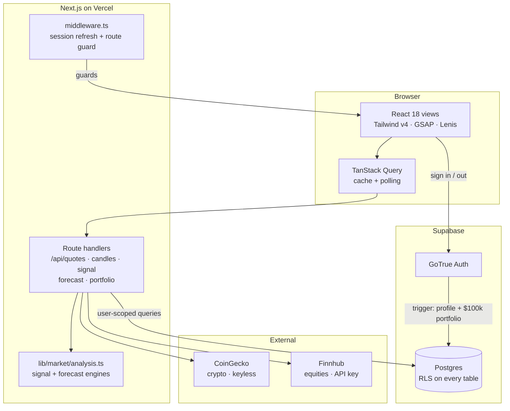

# Veltrix

**A market-analytics terminal that tells you when there is no edge.**

[](https://github.com/VenkataVinesh/Veltrix/actions/workflows/frontend.yml)
[](https://veltrix-terminal-frontend.vercel.app)


Live crypto pricing, a technical signal engine that shows every vote, walk-forward-validated
forecasts with calibrated bands, and paper trading on row-level-secured portfolios.
Next.js 14 · TypeScript · Supabase · lightweight-charts.



## Measured results

| What | Result | Verdict |
|---|---|---|
| Directional hit-rate of the forecast midline, pooled over 1,500 out-of-sample walk-forward calls (6 symbols × 250) | **50.2%** (753/1,500), SE 1.29pp, z = 0.16 | **No edge.** The product says so on the page |
| 95% interval coverage over 1,200 held-out 5-day forecasts | **94.75%** with GARCH(1,1), up from **91.67%** with the EWMA it replaced | **Calibrated.** Use the band, not the midline |
| Ridge regression and gradient-boosted stumps added to the ensemble | RMSE change under 1%, hit-rates pulled toward 50%, 123–443× slower | **Cut** |

Method, per-symbol tables and how to re-run: [docs/FORECAST-EVALUATION.md](docs/FORECAST-EVALUATION.md).

| Forecast and edge report | Command palette (⌘K) | Mobile |
|---|---|---|
|  |  |  |

---

## Why this exists

Most trading dashboards show you a confident number and hide how they got it. A "92% confidence
BUY signal" is easy to render and impossible to check.

Veltrix is built on the opposite premise: **if a number can't be traced, it doesn't ship.**

- Every BUY/SELL exposes the individual indicator votes that produced it, with weights.
- Forecast confidence is a *measured* walk-forward hit-rate — when the model has no edge,
  the UI says ~50% instead of inventing certainty.
- There are no mock data paths. If a provider is unavailable, the screen says so rather
  than falling back to invented prices.

That constraint drove most of the architecture below.

---

## Live demo

**[veltrix-terminal-frontend.vercel.app](https://veltrix-terminal-frontend.vercel.app)**

Sign up with any email. A `handle_new_user` trigger provisions a $100,000 paper portfolio on
signup, so the terminal is usable immediately. Crypto needs no API key, so quotes, candles,
signals and forecasts all work out of the box.

Reviewing this for a role and would rather not create an account? Email me for a demo login with
an already-populated P&L: `venkata-vinesh-kumar-reddy.atluri@etu.ec-lyon.fr`

---

## Architecture



### Request path, end to end

1. **`middleware.ts`** runs on every non-static request, refreshes the Supabase session cookie,
   and redirects unauthenticated users away from `/dashboard`, `/trade`, `/markets`,
   `/portfolio`, `/settings`.
2. **Route handlers** fetch OHLC/quotes from the providers, run the analysis engines
   server-side, and return plain JSON. Market endpoints use Next's `revalidate` for caching;
   `/api/portfolio` is `force-dynamic` because it is per-user.
3. **Postgres reads** go through the caller's JWT, so RLS — not application code — is the
   authorisation boundary.

---

## The signal engine

`computeSignal()` scores five technical components, each casting a weighted vote:

| Component | Weight | Bullish when | Bearish when |
|---|---|---|---|
| RSI (14) | 1.0 | < 30 (oversold) | > 70 (overbought) |
| MACD (12,26,9) | 0.8 | histogram > 0 | histogram < 0 |
| Bollinger (20,2) | 0.6 | close below lower band | close above upper band |
| Trend EMA20/SMA20 | 0.5 | price > EMA20 > SMA20 | price < EMA20 < SMA20 |
| Volume vs 20-bar avg | 0.3 | > 1.5× average | — |

The votes are summed, normalised to `[-1, +1]`, and thresholded: **BUY above +0.3, SELL below −0.3.**

Two deliberate correctness details:

- **The momentum figure is rounded *before* thresholding.** Floating-point (`0.8 - 0.5 =
  0.30000000000000004`) otherwise makes a score of exactly 0.3 render as "0.30" beside a BUY,
  contradicting the stated rule.
- **Bullish/bearish probabilities derive from the same momentum that sets the signal**, so the
  headline and the odds can never disagree.

Every component — including neutral ones — is returned to the client with its measured value,
vote and weight. The UI renders all of them.

---

## The forecast engine

Three models, ensembled by **inverse-RMSE weights from a walk-forward backtest** — a model only
earns weight by actually predicting held-out data:

| Model | Method |
|---|---|
| `drift_ewma` | Geometric drift (shrunk 0.5× toward zero) with RiskMetrics EWMA volatility, λ = 0.94 |
| `ar` | AR(5) on log returns, OLS via normal equations + Gaussian elimination, iterated forward |
| `naive` | Random walk — the benchmark every other model must beat |

Confidence bands are 95% intervals from a **GARCH(1,1)** variance path when the history is long
enough to fit it, and from the EWMA sigma scaled by √horizon otherwise. The response's
`methodology` field says which one was used.

**Reported metrics are measured, not asserted.** MAE, RMSE and directional hit-rate come from a
one-step-ahead walk-forward evaluation over up to 40 held-out points. The UI prints *n* and the
95% margin of error next to every hit-rate, and labels it "not distinguishable from a coin flip"
when it is (at n = 30 the margin is ±18pp).

> Drift is shrunk toward zero on purpose: short-window drift estimates are mostly noise, and an
> honest model does not extrapolate them at full strength.

---

## Data providers

| Source | Covers | Key required | Notes |
|---|---|---|---|
| **CoinGecko** | 10 crypto assets | No | `/ohlc` only accepts 1/7/14/30/90/180/365 days — other values silently return `[]`, so requests snap to the nearest supported value |
| **Finnhub** | 10 equities | `FINNHUB_API_KEY` | Absent key returns an explicit `unavailable` marker; the UI shows a "not configured" state rather than invented prices |

Granularity note: CoinGecko returns 4-hour bars at 30 days but degrades to sparse 4-day bars
above 90, so the signal engine requests 30 days (~180 points) to keep indicators well-fed.

---

## Data model

```sql
profiles    (id → auth.users, email, display_name)
portfolios  (id, user_id → auth.users, name, cash)
positions   (id, portfolio_id → portfolios, symbol, asset_type, quantity, avg_price)
watchlist   (id, user_id → auth.users, symbol, asset_type)
```

RLS is enabled on all four. `portfolios` and `watchlist` match on `auth.uid()`; `positions` is
owned transitively via an `EXISTS` check against the parent portfolio.

A `handle_new_user` trigger on `auth.users` provisions a profile and a $100,000 paper portfolio
on signup, so a new account is immediately usable.

**Verified, not assumed:** an authenticated request returns only that user's rows; the same
query with the anon key alone returns `[]`.

---

## Tech stack

| Layer | Choice |
|---|---|
| Framework | Next.js 14 (App Router, RSC + route handlers) |
| Language | TypeScript, strict |
| Styling | Tailwind CSS v4 with CSS-variable design tokens |
| Charts | `lightweight-charts` v5 (area + candlestick) |
| Motion | GSAP + ScrollTrigger (landing), Lenis smooth scroll, CSS transitions in the app |
| Data layer | TanStack Query |
| Auth & DB | Supabase (GoTrue + Postgres with RLS) |
| Hosting | Vercel |

### Design system (v2, terminal)

Defined as tokens in `app/globals.css`, documented in [docs/DESIGN.md](docs/DESIGN.md).

- **Dense but legible.** 13 px UI text, tabular figures everywhere, a 4 px spacing grid, 10 px
  panel radius, panels with a header row instead of floating cards.
- **Colour carries meaning only.** One accent (lime `#C6F24E`) for focus and primary actions. Up
  `#3DD68C` and down `#FF6B6B` differ in lightness as well as hue, and are always paired with a
  ▲/▼ and a sign. WCAG contrast on the page background: text 16.4:1, secondary 8.5:1, muted
  5.3:1.
- **Keyboard first.** `⌘K` / `Ctrl K` or `/` opens a command palette over pages, 79 symbols and
  actions. `g` then a letter navigates (`g d` dashboard, `g t` trade, `g i` intelligence …), and
  `?` lists every shortcut. Single-key shortcuts are ignored while you type in a field.
- **Every state designed.** Shimmer skeletons shaped like the content, error states with retry,
  "provider not configured" states that name the missing key, and empty states with a next step.
- **Motion is feedback.** 120–180 ms transitions, price flashes on change, transform-only
  entrances (an opacity entrance can leave content invisible if the animation never runs). All
  of it is off under `prefers-reduced-motion`.
- **Responsive by layout, not by shrinking.** An icon rail at 1024 px, rail plus labels from
  1280 px, a stacked layout with a bottom tab bar on phones. Verified at 1440, 1024, 768 and
  390 px.

The landing hero is a generative canvas drawn from the **real 30-day BTC close series**. The
preloader that locks scroll has a 4-second failsafe.

---

## Running locally

```bash
git clone https://github.com/VenkataVinesh/Veltrix.git
cd Veltrix
npm install
npm run dev
```

Open <http://localhost:3000>. It runs with **no configuration** — it falls back to the public
demo Supabase project, and crypto data needs no key.

To point at your own Supabase project, copy `.env.example` to `.env.local`:

```bash
NEXT_PUBLIC_SUPABASE_URL=https://your-project.supabase.co
NEXT_PUBLIC_SUPABASE_ANON_KEY=sb_publishable_xxxxxxxx
FINNHUB_API_KEY=            # optional — enables equities
```

> The Supabase **publishable/anon** key is designed to ship in client bundles; it grants no
> privileges by itself. RLS is the security boundary. Never put the *service role* key here.

```bash
npm test           # vitest: indicators, signal, forecast invariants, and a regression test
                   # that reproduces a captured production /api/signal response from real candles
npx tsc --noEmit   # type check
npm run lint
npm run build      # production build
```

CI runs all four on every push and pull request.

---

## Project layout

```
app/
  (app)/           dashboard · trade · markets · intelligence · macro · portfolio · settings
  api/             quotes · candles · signal · forecast · macro · agents · portfolio
  login/ signup/   Supabase auth
  page.tsx         cinematic landing
components/
  app-shell.tsx    rail, live status bar, mobile tab bar, global shortcuts
  command-palette.tsx  ⌘K palette (pages, symbols, actions)
  edge-report.tsx  the measured-results panel shown on the dashboard, intelligence and landing
  motion/          preloader, kinetic text, reveals, magnetic, cursor, marquee
  views/           one component per screen
  ui/glossary.tsx  plain-English definition for every number the app shows
  hero-canvas.tsx  generative live-data hero
  price-chart.tsx  lightweight-charts wrapper
lib/
  evaluation.ts    offline results, copied from docs/FORECAST-EVALUATION.md (single source)
  market/          providers.ts (CoinGecko/Twelve Data/Finnhub) · analysis.ts (signal +
                   forecast) · ml.ts (GARCH, plus two models the backtest rejected) ·
                   macro.ts (FRED series)
  agents/          multi-agent debate — context gathering, prompts, engine
  supabase/        client · server · config
middleware.ts      session refresh + route guarding (public allowlist, fails closed)
tests/             vitest suite + real captured BTC candles as a fixture
docs/
  FORECAST-EVALUATION.md   what was measured, and what got cut for failing
  DESIGN.md                tokens, type scale, components
  screenshots/             current UI (and before/ for the previous design)
```

---

## Honest limitations

Stated plainly, because the whole point of the project is not overclaiming:

- **The forecast has no directional edge, and this is measured.** Pooled over 1,500
  out-of-sample walk-forward calls the hit-rate is 50.2% (z = 0.16) — a coin flip. Ridge
  regression and gradient-boosted trees were built, backtested and cut for failing to beat
  that. What *is* calibrated is the 95% band: 94.75% measured coverage against 95% nominal,
  after GARCH(1,1) replaced an EWMA estimate that was delivering only 91.7%. Use the band,
  not the midline. Full method and tables: [docs/FORECAST-EVALUATION.md](docs/FORECAST-EVALUATION.md).
- **Sell orders are not implemented.** The button is visibly disabled and labelled.
- **Paper trading only.** No broker integration; no real order ever leaves the browser.
- **Not investment advice.** The signal engine is a transparent technical composite, not alpha.
- **Free-tier rate limits.** CoinGecko, Finnhub and Twelve Data all throttle; heavy refreshing
  will 429. Twelve Data's free daily budget is 800 credits.
- **Equities need a key.** Without `TWELVEDATA_API_KEY` there is no equity history, so no
  stock signals or forecasts — the app says so rather than inventing bars.

---

## Licence

MIT — see [LICENSE](LICENSE).

Built by **Venkata Vinesh Kumar Reddy Atluri** ·
[Portfolio](https://venkatavinesh.github.io/PortFolio_Build_Gem/) ·
[LinkedIn](https://www.linkedin.com/in/venkat-vinesh)
